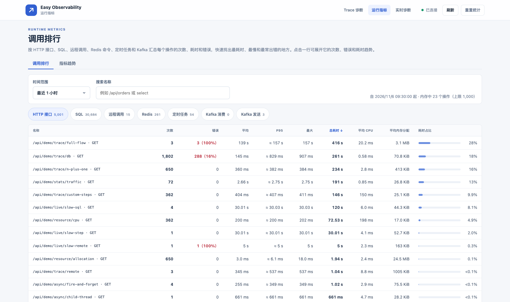
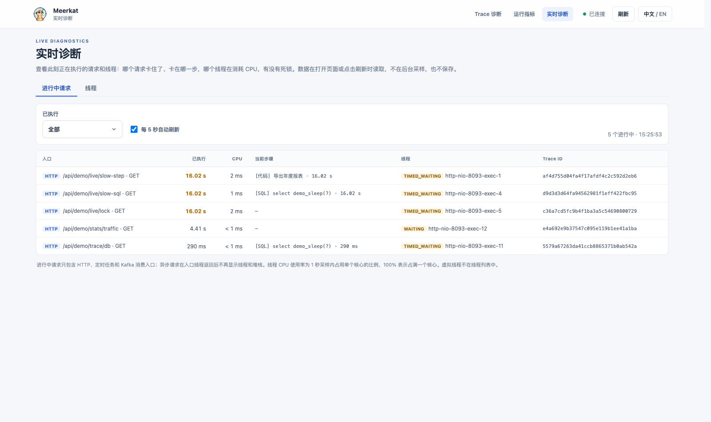

# Easy Observability

**Spring Boot 3/4 内嵌式 Trace 诊断与运行指标。**

Easy Observability 帮助应用开发者快速回答两个问题：一次请求慢在哪里、异常从哪里开始；服务的请求量、错误和依赖耗时最近有什么变化。引入一个 Starter，即可在应用内查看 Trace 时间线和常用运行指标，不必先部署一套独立观测平台。

[](https://github.com/lakernote/easy-observability/actions/workflows/ci.yml)
[](https://central.sonatype.com/artifact/io.github.lakernote/easy-observability-spring-boot-3-starter)
[](https://central.sonatype.com/artifact/io.github.lakernote/easy-observability-spring-boot-4-starter)

## 解决什么问题

- **单次请求定位：** 从 HTTP、定时任务或 Kafka 消费入口查看调用时间线，串联 JDBC、Redis、远程 HTTP、Kafka 和已接入的异步任务；慢调用、错误及 CPU 时间或内存分配量超阈值的入口会进入诊断列表。
- **调用排行：** 不论快慢，按 HTTP 接口、SQL、远程调用、Redis 命令、定时任务和 Kafka 统计次数、错误率、平均/P95/最大耗时和总耗时，入口另有平均 CPU 和内存分配量，可看最近 1 小时、今天、7 天和 30 天，重启不丢；展开一行查看它的次数和耗时趋势。
- **趋势查看：** 查看各类调用的次数、错误和耗时趋势，以及 JVM/GC、CPU、线程、Hikari 连接池、线程池等资源曲线，识别问题出现的时间和变化方向。资源指标直接复用 Spring Boot Actuator 已绑定的 Micrometer 指标。
- **实时诊断：** 查看此刻正在执行的请求已经跑了多久、卡在哪个 SQL 或远程调用、线程堆栈和 CPU；按 CPU 使用率排出线程、检测死锁、合并相同堆栈，并可下载线程 Dump。按需读取，不在后台采样。
- **轻量接入：** 通过 Spring Boot Starter 自动配置，不需要外部存储。指标按天写入存储目录下的文本文件，旧数据自动压缩、按保留期和容量上限删除；应用现有的 Micrometer 导出（例如 Prometheus、InfluxDB）不受影响。

## 界面预览

诊断列表只收录慢、出错或资源超阈值的入口：


打开一条记录，沿调用时间线定位根因；循环里重复的 SQL 会合并成一行并提示 N+1：


调用排行按总耗时、错误、P95 等找出最值得优化的接口和 SQL：



指标趋势查看 JVM、GC、连接池、线程池等资源的历史曲线：


实时诊断查看此刻正在执行的请求卡在哪一步：



## 快速接入

选择与应用 Spring Boot 主版本匹配的 Starter（Java 17+，Spring Boot 3.5+ / 4.0+，Spring MVC 等 Servlet Web 应用；WebFlux 不支持，见[运行环境](docs/guide.md#运行环境)）：

```xml
<!-- Spring Boot 3 -->
<dependency>
    <groupId>io.github.lakernote</groupId>
    <artifactId>easy-observability-spring-boot-3-starter</artifactId>
    <version>0.1.0-alpha.4</version>
</dependency>
```

```xml
<!-- Spring Boot 4 -->
<dependency>
    <groupId>io.github.lakernote</groupId>
    <artifactId>easy-observability-spring-boot-4-starter</artifactId>
    <version>0.1.0-alpha.4</version>
</dependency>
```

默认启用 Trace、运行指标和嵌入页面。应用启动完成时日志会打印页面地址（`Easy Observability dashboard: http://localhost:8080/easy-observability/`），也可直接访问：

- Trace 诊断：`/easy-observability/`
- 调用排行：`/easy-observability/stats/`
- 指标趋势：`/easy-observability/metrics/`
- 实时诊断：`/easy-observability/live/`

生产环境请通过应用现有的 Spring Security 或网关保护页面和 API；Starter 不创建独立账号或登录系统。常用配置、采集范围和访问控制说明见[接入与配置指南](docs/guide.md)。

## 性能开销

采集在业务线程上增加的开销（JMH 基准，Apple M4 Pro，JDK 21，单线程平均）：

| 场景 | 增加的耗时 |
| --- | --- |
| 一次入口请求（HTTP、定时任务、Kafka 消费），不含依赖调用 | 约 1.7 µs |
| 每次依赖调用（Redis、远程 HTTP、Kafka 发送等） | 约 0.3 µs |
| 每条 SQL | 约 0.1 µs（不在 Trace 中）/ 0.2 µs（在 Trace 中） |

一个包含 20 次依赖调用的请求合计约 7 µs，对耗时 1 ms 以上的请求增加不到 1%，对 10 ms 的请求不到 0.1%。归档写盘在后台线程进行。测试方法和完整数据见[性能开销](docs/guide.md#性能开销)。

## 本地体验

示例包含 JDBC、Redis、远程 HTTP、Kafka、异步线程池及资源消耗场景，可直接生成 Trace 和运行指标：

```bash
docker compose -f examples/docker-compose.yml up -d --wait
mvn -pl examples/easy-observability-example-spring-boot-3 -am package
java -jar examples/easy-observability-example-spring-boot-3/target/easy-observability-example-spring-boot-3-0.1.0-alpha.4.jar
```

打开 `http://localhost:8083/` 查看示例入口。更多场景和 Boot 4 启动方式见[示例说明](examples/README.md)。

## 与其他方案的定位

| | Easy Observability | JavaMelody | SkyWalking / Pinpoint 等 APM | Prometheus + Grafana |
|---|---|---|---|---|
| 部署 | 应用内 Starter，无额外服务 | 应用内依赖，无额外服务 | Java Agent + 独立收集端、存储和 UI | 独立的 Prometheus、Grafana |
| 单次请求调用树 | 有：慢、错、资源超阈值的入口，含异步线程、SQL、Redis、远程调用、Kafka | 无，侧重汇总统计 | 有，且支持跨服务链路 | 无 |
| 汇总统计与趋势 | 调用排行（P95、错误率、CPU、内存分配）+ 资源趋势 | 有，覆盖 HTTP、SQL、Spring Bean 等 | 有 | 有，查询和告警能力最强 |
| 实时诊断 | 进行中请求的当前步骤、线程 CPU、死锁、线程 Dump | 当前请求、线程、堆直方图等 | 部分产品提供 | 无 |
| 适合 | 单体或少量服务，想在应用内直接看到慢在哪、错在哪 | 传统 Java Web 应用的运行概览 | 多服务分布式链路、集中运维 | 集中化指标监控与告警 |

Easy Observability 不替代集中式 APM 或指标平台；应用已有的 Micrometer 指标导出不受影响，可以和它们并存。

