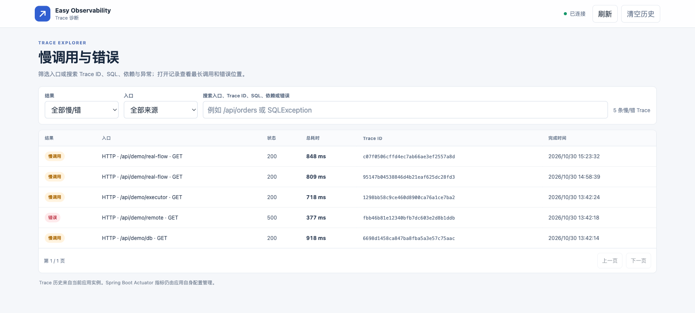
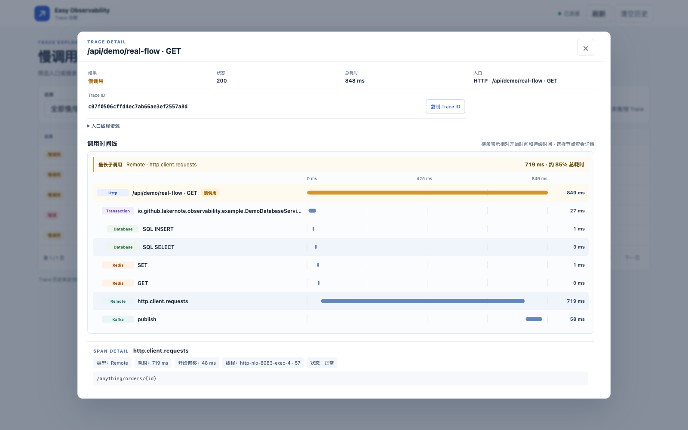

# Easy Observability

**Spring Boot Trace 与公共指标诊断 Starter**

[更新记录](CHANGELOG.md)

面向 Spring Boot 3/4 应用的轻量嵌入式排障工具。它从 HTTP 请求、定时任务和 Kafka 消费入口采集 Trace，并串联可观测到的 JDBC、Redis、事务及远程调用，帮助快速定位慢调用、异常、CPU 消耗和内存分配问题。Trace ID 可沿受支持的 HTTP 客户端和 Kafka 消息传播；页面和有界历史聚焦当前应用实例。

项目提供 Spring Boot 3 和 Spring Boot 4 两个 Starter。除 Trace 诊断外，组件还会把一组固定的公共运行指标写入本地 RRD 历史，并在嵌入页面展示趋势。该历史使用独立的 Micrometer `StepMeterRegistry`，不会替换或重新配置应用已有的 InfluxDB 等指标后端。

[](https://central.sonatype.com/artifact/io.github.lakernote/easy-observability-spring-boot-3-starter)
[](https://central.sonatype.com/artifact/io.github.lakernote/easy-observability-spring-boot-4-starter)

## 界面预览

Trace 诊断页汇总慢调用、错误以及 CPU 时间或内存分配量超阈值的入口；打开记录后，可沿时间线查看数据库、Redis、远程调用等节点，并定位耗时最长的子调用或资源告警。

指标趋势页仅展示公共运行指标，并使用固定指标清单和定长本地历史；不会把应用所有自定义 Meter 自动写入 RRD。





## 安装

按应用的 Spring Boot 主版本选择一个 Starter：

```xml
<!-- Spring Boot 3 -->
<dependency>
    <groupId>io.github.lakernote</groupId>
    <artifactId>easy-observability-spring-boot-3-starter</artifactId>
    <version>0.1.0-alpha.1</version>
</dependency>
```

```xml
<!-- Spring Boot 4 -->
<dependency>
    <groupId>io.github.lakernote</groupId>
    <artifactId>easy-observability-spring-boot-4-starter</artifactId>
    <version>0.1.0-alpha.1</version>
</dependency>
```

当前为预览版本，需要 Java 17+ 和 Maven 3.6.3+。在仓库根目录运行 `mvn verify` 可构建两个 Starter 和示例应用。

## 模块结构

```text
easy-observability-spring-boot-common/           # Trace 实现、页面及共享自动配置
easy-observability-spring-boot-3-autoconfigure/ # Boot 3 自动配置
easy-observability-spring-boot-3-starter/       # Boot 3 依赖入口
easy-observability-spring-boot-4-autoconfigure/ # Boot 4 自动配置
easy-observability-spring-boot-4-starter/       # Boot 4 依赖入口
examples/                                       # 两个 Boot 版本的端到端示例
```

应用只需引入对应 Starter。它包含 Actuator 以使用 Spring Boot 的 Observation 基础设施；Starter 不覆盖应用已有的 `MeterRegistry` 或 `ObservationRegistry`，也不额外开放 Actuator 端点。应用是否暴露 Actuator 指标由应用自行配置。

## 自动 Trace 与接入边界

自动入口 Trace 来自 Spring MVC HTTP、Spring `@Scheduled` 和启用 Observation 的 Spring Kafka Listener。入口下游调用会作为 Span 加入当前 Trace；没有入口上下文时，不会为单个依赖调用创建伪造的请求 Trace。

| 操作 | Trace 行为 | 边界 |
| --- | --- | --- |
| HTTP server | 记录入口路由、状态、耗时和错误 | 非 Spring MVC 入口需要显式接入 |
| Spring HTTP client、OkHttp | 在对应客户端 Observation 可用时记录远程调用；Spring 管理的 `RestClient.Builder` 自动传递 Trace ID；Spring 容器中的 OkHttpClient 会自动增强 | `RestClient.create()` 等绕过 Spring Builder 的客户端不会自动增强 |
| JDBC | 在当前 Trace 中记录脱敏 SQL 模板、耗时和错误 | 自动采集；不记录绑定参数，也不做 SQL 汇总统计 |
| Spring 事务、MyBatis | 记录事务范围；MyBatis SQL 通过 DataSource/JDBC 监听器记录为 SQL Span | 不额外创建 Mapper Span；自定义事务或非 Spring 边界需自行接入 |
| Redis | Lettuce Observation 自动记录命令级 Span，保留命令、耗时和错误 | Spring Boot 3/4 的 Lettuce Observation 接入随 Starter 自动配置；自定义 `ClientResources` 需自行接入 Observation |
| Kafka | Listener 和 producer Observation 记录为入口或依赖 Span，并传播 Trace ID | Spring Kafka 需要启用 Listener/Template Observation；自定义消费者需自行接入 |
| 线程池任务 | `TraceContextTaskDecorator` 在线程池边界传播活动 Trace，并自动记录任务耗时和异常 | 在线程池配置一次装饰器；无活动父 Trace 时不创建任务节点 |
| 业务方法 | `TraceBlock` 或 `@TraceSpan` 添加业务 Span | 不扫描所有 Service；`@TraceSpan` 需要应用已有 Spring AOP |

组件维护自己的 RRD4J `StepMeterRegistry`，只接受下文列出的公共指标，并限制会形成历史序列的标签数量。应用已有的 `MeterRegistry`（例如 InfluxDB）仍按原配置工作；Micrometer 的 Composite registry 会把观察数据同时发送给各 registry。RRD 历史只在当前实例本地保存，不会跨实例汇总。

公共指标范围包括 HTTP 入口/出口请求数、错误数和平均耗时，定时任务与 Kafka Listener/发送，Redis/Lettuce 命令延迟，JVM 内存池与 GC 暂停，进程/系统 CPU、JVM 活跃线程，以及 Spring/JDK 线程池活跃数、排队数、池大小、最大值和完成任务数。历史保留有助于定位问题的有限标签维度：HTTP 方法与 URI、任务和 Kafka 名称、Redis 命令、JVM 内存池、GC 事件和线程池名称均可独立成线；每类维度设有上限，超出部分进入“其他”。点击图例可隐藏或显示曲线，拖动可缩放时间范围。CPU 和活跃线程等实例级指标按实例展示；Trace 用于查看单次调用细节。Kafka 发送/消费指标遵循 Spring Kafka Observation 开关；Redis 命令指标在 Lettuce Observation 可用时记录，不会为了历史指标改写应用的 Observation 配置。

短时间范围按配置的采样周期显示；默认 60 秒采样时，7 天和 30 天范围分别使用约 5 分钟和 1 小时分辨率。更改采样周期后，归档间隔会按采样周期取整，并由查询接口返回实际间隔。长时间范围中的每个点是该归档区间内已有采样值的平均，不是区间总数；平均耗时先按采样周期计算，降采样后也不是按请求数加权的全时段均值。部分 JVM 内存池没有固定上限，不会绘制该池的上限线。

指标页面地址为 `/easy-observability/metrics/`，只读 API 为 `/api/easy-observability/metrics?period=1h|24h|7d|30d`。历史默认每分钟采样、保留 30 天，RRD 文件上限 64 MiB。可配置存储目录和上限；调整采样周期或保留周期会重建固定大小的 RRD 文件并清除旧的本地指标历史。每个服务实例应使用自己的本地目录，不要让多个进程同时写同一个 RRD 文件。

Redis 接入复用 Lettuce 的 Micrometer Observation，不单独注册 Meter；应用若启用了 Actuator 的 Meter handler，也会看到 Lettuce 自带的命令耗时指标。

## Trace 诊断与根因定位

诊断列表只保留慢调用、错误或 CPU 时间/内存分配量超阈值的入口，不会显示普通请求。列表支持按入口、结果类型和文本搜索，可匹配 Trace ID、SQL、依赖名称与错误摘要。详情包含入口总耗时、各调用节点耗时、HTTP 状态、线程信息及调用时间线，并显示入口线程在本次入口执行期间消耗的 CPU 时间和累计内存分配量。CPU 时间不是 CPU 使用率；内存分配量不是当前堆占用，两个数都不包含子线程。单个依赖错误会标记在对应 Span 上；依赖耗时仍完整保留，便于从入口 Trace 中定位耗时步骤。

捕获到异常时，详情和诊断归档会保存异常类型、消息及有界堆栈；HTTP 5xx 等只有状态码的错误会标记为错误，但没有异常对象时不会生成虚构堆栈。SQL 会在进入 Trace 前清理字面量和注释。调用树和异常堆栈均有大小限制，避免单条异常无限扩张存储。

慢调用、错误及资源超阈值 Trace 会同时保留在有界内存近期列表和本地 JSONL 文件中；正常 Trace 不会占用这两处历史记录。默认文件为 `./data/easy-observability/traces.jsonl`；多实例之间不会自动汇总。Trace ID 默认通过 `X-Trace-Id` 请求头传递。页面路径为 `/easy-observability/`，Trace API 路径为 `/api/easy-observability`；查询接口为 GET，清空历史为 `POST /api/easy-observability/storage/clear`。诊断筛选 API 为 `/api/easy-observability/diagnostics?kind=slow|error|resource`。

## 配置

以下配置均可省略；默认开启 Trace、HTTP 页面及 JDBC/Redis/事务节点采集，并在每个入口采集入口线程在入口执行期间的 CPU 时间和内存分配量。CPU 时间表示入口线程实际运行在 CPU 上的累计时间，不是 CPU 使用率；内存分配量是该线程期间创建对象的累计大小，不是当前堆占用。两项数据均不包含子线程。Starter 会提供线程池上下文装饰器 Bean，在线程池配置使用后才会传播和记录任务。慢阈值仅用于 HTTP、定时任务和 Kafka 消费入口；设为 `0` 或负数可关闭对应入口的慢分类。依赖节点始终记录耗时和错误，不单独按慢阈值标记；所有命中的诊断 Trace 都会保留。

```yaml
easy:
  observability:
    enabled: true
    trace:
      enabled: true
      header-name: X-Trace-Id
      http-slow-threshold-ms: 500
      job-slow-threshold-ms: 1000
      kafka-consumer-slow-threshold-ms: 1000
      cpu-threshold-ms: 500
      allocated-memory-threshold: 50MB
      diagnostic-trace-file: ./data/easy-observability/traces.jsonl
      diagnostic-history-limit: 1000
      diagnostic-max-bytes: 8MB
    metrics:
      enabled: true
      step: 60s
      storage-directory: ./data/easy-observability/metrics
      retention-days: 30
      max-storage-bytes: 64MB
    web:
      enabled: true
      allow-anonymous: false
      trace-limit: 500
```

| 配置 | 默认值 | 作用 |
| --- | --- | --- |
| `easy.observability.enabled` | `true` | Starter 总开关；关闭后不创建 Easy Observability 自动配置 |
| `easy.observability.trace.enabled` | `true` | Trace 采集和上下文传播总开关 |
| `easy.observability.trace.header-name` | `X-Trace-Id` | HTTP 请求/响应及受支持客户端、Kafka 消息使用的 Trace ID 名称 |
| `easy.observability.trace.http-slow-threshold-ms` | `500` | HTTP 入口慢阈值 |
| `easy.observability.trace.job-slow-threshold-ms` | `1000` | 定时任务入口慢阈值 |
| `easy.observability.trace.kafka-consumer-slow-threshold-ms` | `1000` | Kafka 消费入口慢阈值 |
| `easy.observability.trace.cpu-threshold-ms` | `500` | 入口线程 CPU 时间达到该值时保存资源告警 Trace；设为 `0` 或负数关闭 CPU 触发 |
| `easy.observability.trace.allocated-memory-threshold` | `50MB` | 入口线程累计分配量达到该值时保存资源告警 Trace；支持 `8MB` 等大小写法，设为 `0B` 关闭分配量触发 |
| `easy.observability.trace.diagnostic-trace-file` | `./data/easy-observability/traces.jsonl` | 诊断入口 Trace 的 JSONL 归档路径，相对路径以应用工作目录为基准 |
| `easy.observability.trace.diagnostic-history-limit` | `1000` | 诊断归档索引的最大记录数；实际下限为 `100` |
| `easy.observability.trace.diagnostic-max-bytes` | `8MB` | JSONL 诊断归档文件上限；实际下限为 `1MB`，超限时保留较新的记录 |
| `easy.observability.metrics.enabled` | `true` | 公共指标采集和本地 RRD 历史总开关；不影响应用其他指标后端 |
| `easy.observability.metrics.step` | `60s` | 指标采样周期，允许范围 10 秒至 1 小时 |
| `easy.observability.metrics.storage-directory` | `./data/easy-observability/metrics` | RRD 历史目录，相对路径以应用工作目录为基准 |
| `easy.observability.metrics.retention-days` | `30` | 本地历史保留时间，允许范围 7 至 365 天；较早数据以更粗粒度归档 |
| `easy.observability.metrics.max-storage-bytes` | `64MB` | RRD 历史文件大小上限；配置需足以容纳当前采样周期、保留期和固定指标集 |
| `easy.observability.web.enabled` | `true` | 是否提供 Trace/指标页面和查询 API |
| `easy.observability.web.allow-anonymous` | `false` | 默认访问策略是否允许匿名调用 Trace 与指标 API；不是认证配置，也不保护页面文件本身 |
| `easy.observability.web.trace-limit` | `500` | 最近诊断入口 Trace 的内存窗口容量，不影响 JSONL 归档容量 |

### 页面访问控制

Starter 不提供用户名、密码、登录页或独立的用户系统。`easy.observability.web.allow-anonymous` 只决定默认 `ObservabilityAccessPolicy` 是否放行 Trace 和指标 API：默认 `false` 时，默认策略拒绝所有 API 请求（到达控制器时返回 403），即使应用已完成登录也需提供自己的 `ObservabilityAccessPolicy`；设为 `true` 时，默认策略允许匿名 API 请求，但应用已有的 Spring Security、网关或网络访问控制仍然有效。

该策略只在 Trace/指标 API 控制器中检查。HTML 页面 `/easy-observability/**` 和静态资源 `/easy-observability/assets/**` 不经过 `ObservabilityAccessPolicy`；若页面本身也不能公开，应在应用现有的 Spring Security `SecurityFilterChain` 或反向代理中，同时保护 `/easy-observability/**` 和 `/api/easy-observability/**`。生产环境通常复用应用已有的登录和角色，不需要为这个嵌入式页面再建一套认证；再提供策略 Bean，将当前登录用户的权限用于 API 授权。例如：

```java
import io.github.lakernote.observability.web.ObservabilityAccessPolicy;
import org.springframework.context.annotation.Bean;
import org.springframework.security.authentication.AnonymousAuthenticationToken;
import org.springframework.security.core.context.SecurityContextHolder;

@Bean
ObservabilityAccessPolicy observabilityAccessPolicy() {
    return () -> {
        var authentication = SecurityContextHolder.getContext().getAuthentication();
        return authentication != null
                && authentication.isAuthenticated()
                && !(authentication instanceof AnonymousAuthenticationToken)
                && authentication.getAuthorities().stream()
                    .anyMatch(authority -> authority.getAuthority().equals("ROLE_OBSERVABILITY_VIEW"));
    };
}
```

上例需要应用已有 Spring Security。也可在 `ObservabilityAccessPolicy` Bean 中调用应用自己的授权服务。该策略目前同时保护 Trace 查询和清空历史的 `POST /api/easy-observability/storage/clear`；若查看者不能清空历史，应在应用的 `SecurityFilterChain` 或网关中单独要求该 POST 路径具备管理权限。`allow-anonymous=true` 适用于可信的本地示例环境，不适合直接暴露到不可信网络。近期内存窗口和 JSONL 归档保存慢、错误或 CPU/分配量达到阈值的入口 Trace；`web.trace-limit` 控制内存窗口，`diagnostic-history-limit` 控制归档索引条数，`diagnostic-max-bytes` 控制磁盘文件大小。

页面也可嵌入同源 iframe。父页面收到 `easy-observability:auth-request` 后，可向 iframe 回发 `easy-observability:auth-response` 和应用的 Bearer token；页面会将 token 加到 Trace API 请求的 `Authorization` 头。Starter 本身不校验该 token，应用的 Spring Security 或网关仍需负责验证和授权。若应用使用同源 Cookie 登录，页面 API 请求会自动携带同源凭证，不需要额外传 token。内置的清空历史按钮会发送 POST，但目前不会自动附带应用的 CSRF token；如果 Spring Security 的 CSRF 保护启用，需要将现有 CSRF token 接入该请求。

### Kafka Listener Trace 接入范围

Kafka 消费端从消息头恢复 Trace ID，并提供 `TraceIdRecordInterceptor` 给 Spring Boot 默认 Listener Factory，因此使用默认 Factory 的 `@KafkaListener` 通常无需额外配置。生产端自动写入消息头；Spring Kafka 还需启用 Listener/Template Observation，Trace ID 才能跨生产和消费关联。

拦截器在 Listener 执行前读取消息头（默认 `X-Trace-Id`），恢复当前线程上下文；消息头缺失或格式无效时会生成新的 Trace ID。Listener 执行后会恢复线程原有上下文。它不读取消息体，也不会自动接入原生 `KafkaConsumer`、Kafka Streams 或绕过 Spring Boot Listener Factory 的自定义消费代码。

Kafka 自动接入由类路径上的 Spring Kafka 和 `easy.observability.enabled`、`easy.observability.trace.enabled` 控制，没有单独的 Kafka 开关。若应用已定义自己的 `RecordInterceptor` Bean，Starter 会让出该 Bean；请显式组合 Trace 拦截器。自定义 Listener Factory 若不使用 Boot 的 Factory 配置器，也需手动设置：

```java
@Bean
ConcurrentKafkaListenerContainerFactory<String, String> ordersListenerFactory(
        ConsumerFactory<String, String> consumerFactory,
        TraceIdRecordInterceptor traceInterceptor) {
    var factory = new ConcurrentKafkaListenerContainerFactory<String, String>();
    factory.setConsumerFactory(consumerFactory);
    factory.setRecordInterceptor(traceInterceptor);
    return factory;
}

@KafkaListener(topics = "orders", containerFactory = "ordersListenerFactory")
public void consume(String message) {
    // 这里可读取 TraceIdContext.currentTraceId() 获取当前消息的 Trace ID。
}
```

如果 Factory 已有拦截器，用 Spring Kafka 的 `CompositeRecordInterceptor` 组合。Trace 拦截器放在前面，让应用拦截器可以读取当前 Trace ID：

```java
factory.setRecordInterceptor(new CompositeRecordInterceptor<>(
        new TraceIdRecordInterceptor<>(properties),
        existingInterceptor));
```

## 手动添加业务 Span

```java
return TraceBlock.call("partner.lookup", SpanKind.REMOTE, "partner-api",
        () -> partnerClient.lookup(accountId));
```

在线程池上配置一次公共装饰器即可自动记录任务边界，不需要在每个任务里手动调用 Trace API：

```java
@Bean("billingExecutor")
ThreadPoolTaskExecutor billingExecutor(TraceContextTaskDecorator traceTaskDecorator) {
    ThreadPoolTaskExecutor executor = new ThreadPoolTaskExecutor();
    executor.setCorePoolSize(4);
    executor.setTaskDecorator(traceTaskDecorator);
    return executor;
}
```

后续照常提交任务；装饰器会在线程池边界自动创建 `executor.task` Trace 节点。

Spring 管理的 `RestClient.Builder` 也会自动传递当前 Trace ID，并使用 Spring Boot 的 Observation 记录远程调用。通过 `RestClient.create()` 或独立 `RestClient.builder()` 绕过 Spring Builder 时，不会应用 Starter 的 Trace ID 拦截器。

## 运行示例

示例演示 JDBC 查询、事务回滚、Redis、远程 HTTP、Kafka 和异步线程池上下文传播 Trace。启动本地依赖后运行任一示例：

```bash
docker compose -f examples/docker-compose.yml up -d --wait
mvn -pl examples/easy-observability-example-spring-boot-3 -am package
java -jar examples/easy-observability-example-spring-boot-3/target/easy-observability-example-spring-boot-3-0.1.0-alpha.1.jar
```

Boot 3 示例运行在 `http://localhost:8083/`，Boot 4 示例运行在 `http://localhost:8084/`。示例启用了匿名 Trace 页面，仅用于本地体验。完整场景见 [示例使用说明](examples/README.md)。

## Maven Central 发布

项目按 Maven Central 发布格式构建全部模块。发布前需要配置 Sonatype Central 凭据和 GPG 签名；发布步骤及签名配置见 [贡献指南](CONTRIBUTING.md)。
