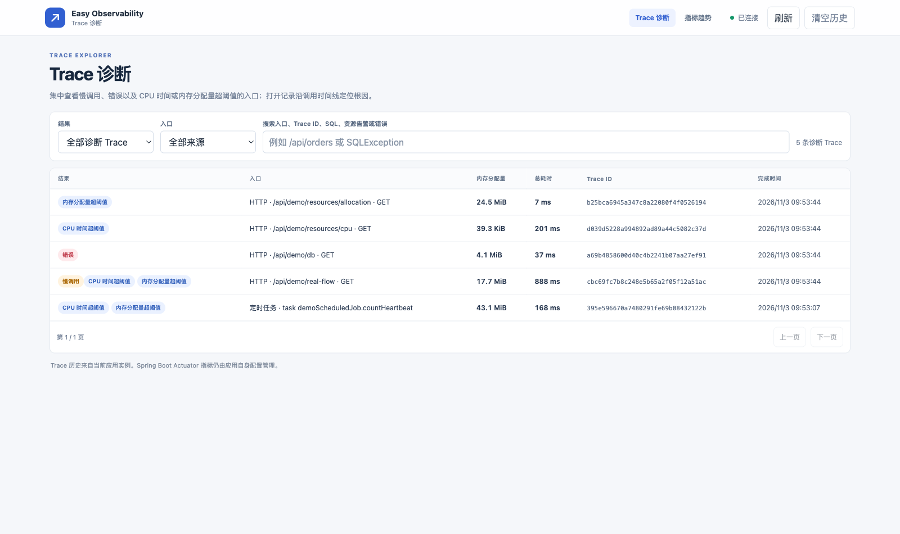
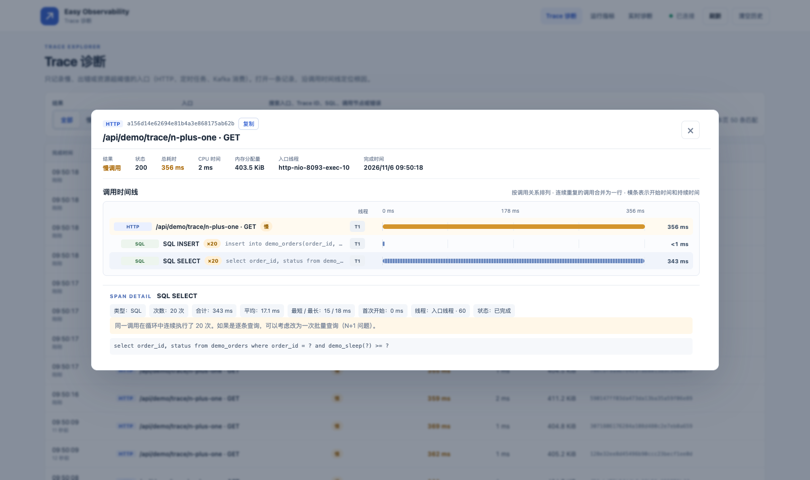
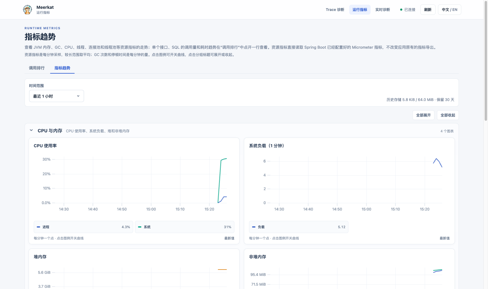

# Easy Observability

**Spring Boot 3/4 内嵌式 Trace 诊断与公共 Metrics 趋势。**

Easy Observability 帮助应用开发者快速回答两个问题：一次请求慢在哪里、异常从哪里开始；服务的请求量、错误和依赖耗时最近有什么变化。引入一个 Starter，即可在应用内查看 Trace 时间线和常用运行指标，不必先部署一套独立观测平台。

[](https://github.com/lakernote/easy-observability/actions/workflows/ci.yml)
[](https://central.sonatype.com/artifact/io.github.lakernote/easy-observability-spring-boot-3-starter)
[](https://central.sonatype.com/artifact/io.github.lakernote/easy-observability-spring-boot-4-starter)

## 解决什么问题

- **单次请求定位：** 从 HTTP、定时任务或 Kafka 消费入口查看调用时间线，串联 JDBC、Redis、远程 HTTP、Kafka 和已接入的异步任务；慢调用、错误及 CPU 时间或内存分配量超阈值的入口会进入诊断列表。
- **趋势查看：** 在内嵌 Metrics 页面查看 HTTP、任务、Kafka、Redis、JVM/GC、CPU 和线程池等公共指标，识别问题出现的时间和变化方向。
- **轻量接入：** 通过 Spring Boot Starter 自动配置。指标历史只保存组件定义的公共指标，使用有界的本地 RRD 存储；应用现有 Micrometer registry（例如 InfluxDB）仍按原配置工作。

## 界面预览

诊断列表聚焦需要排查的入口：



打开一条记录查看入口资源、线程泳道和依赖调用的相对时序：



Metrics 页面按指标类别查看历史曲线，点击图例可切换序列：



## 快速接入

选择与应用 Spring Boot 主版本匹配的 Starter（Java 17+，Spring MVC 等 Servlet Web 应用；WebFlux 不支持，见[运行环境](docs/guide.md#运行环境)）：

```xml
<!-- Spring Boot 3 -->
<dependency>
    <groupId>io.github.lakernote</groupId>
    <artifactId>easy-observability-spring-boot-3-starter</artifactId>
    <version>0.1.0-alpha.4</version>
</dependency>
```

```xml
<!-- Spring Boot 4 -->
<dependency>
    <groupId>io.github.lakernote</groupId>
    <artifactId>easy-observability-spring-boot-4-starter</artifactId>
    <version>0.1.0-alpha.4</version>
</dependency>
```

默认启用 Trace、公共 Metrics 和嵌入页面。应用启动后访问：

- Trace 诊断：`/easy-observability/`
- Metrics 趋势：`/easy-observability/metrics/`

生产环境请通过应用现有的 Spring Security 或网关保护页面和 API；Starter 不创建独立账号或登录系统。常用配置、采集范围和访问控制说明见[接入与配置指南](docs/guide.md)。

## 本地体验

示例包含 JDBC、Redis、远程 HTTP、Kafka、异步线程池及资源消耗场景，可直接生成 Trace 和 Metrics：

```bash
docker compose -f examples/docker-compose.yml up -d --wait
mvn -pl examples/easy-observability-example-spring-boot-3 -am package
java -jar examples/easy-observability-example-spring-boot-3/target/easy-observability-example-spring-boot-3-0.1.0-alpha.4.jar
```

打开 `http://localhost:8083/` 查看示例入口。更多场景和 Boot 4 启动方式见[示例说明](examples/README.md)。
