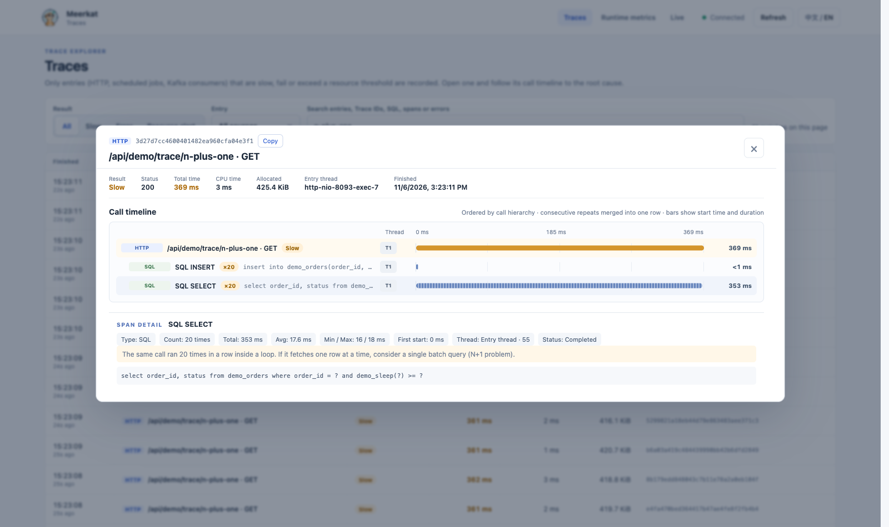
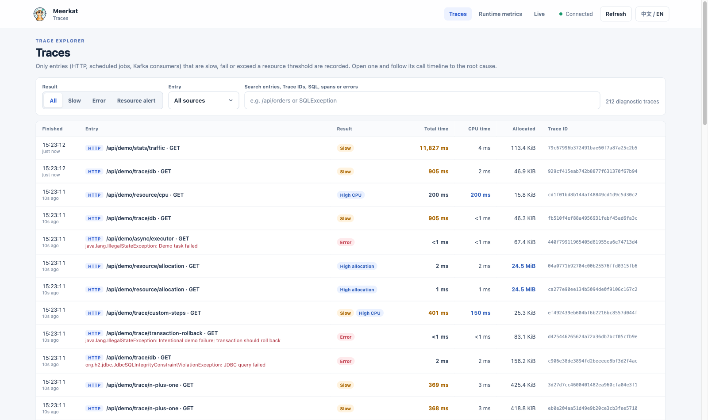
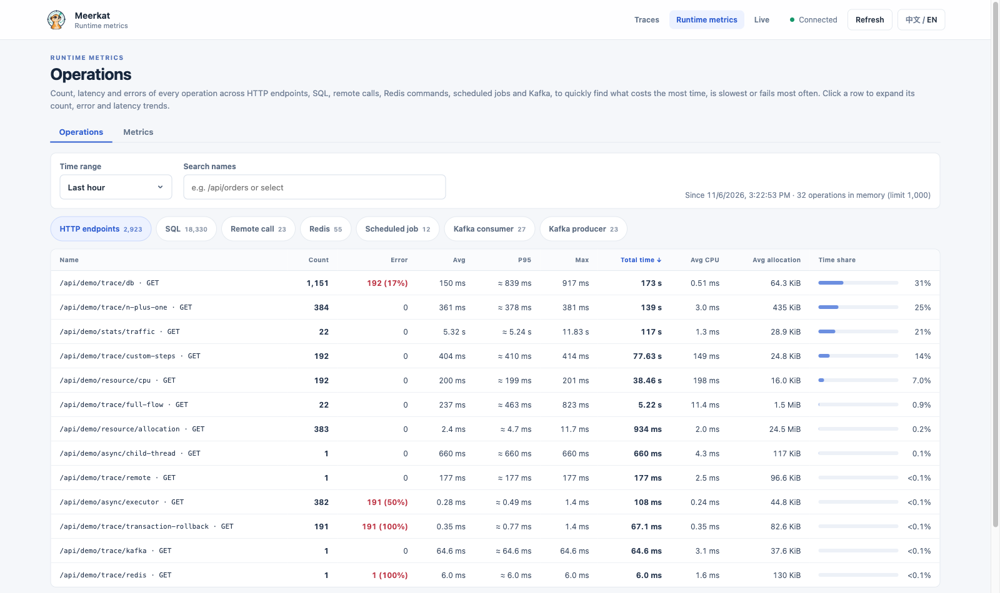
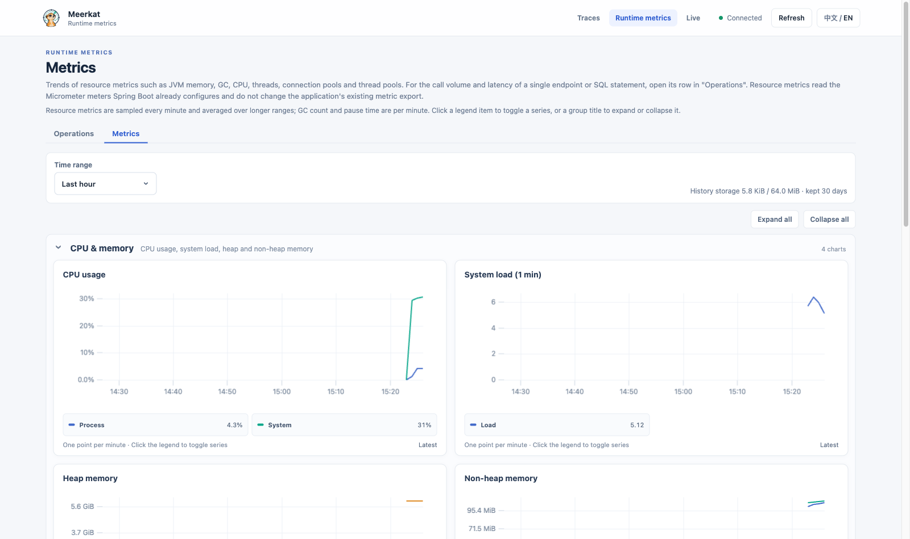
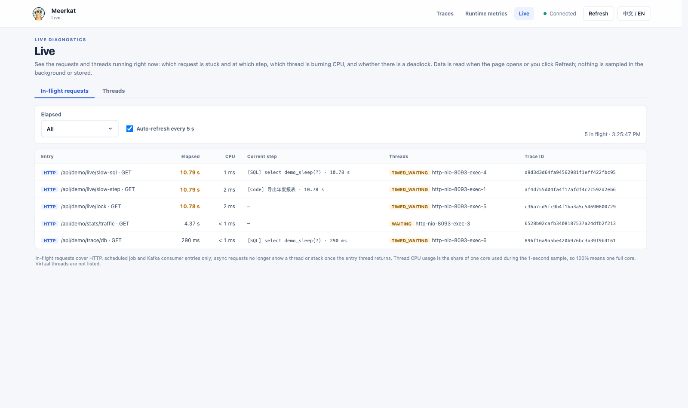

<p align="center">
  
</p>

<h1 align="center">Meerkat</h1>

<p align="center">
  <b>Embedded trace diagnostics and runtime metrics for Spring Boot 3/4.</b><br>
  Add one dependency. No agent, no collector, no code changes.
</p>

<p align="center">
  <a href="https://github.com/lakernote/meerkat/actions/workflows/ci.yml"></a>
  <a href="https://central.sonatype.com/artifact/io.github.lakernote/meerkat-spring-boot-3-starter"></a>
  <a href="https://central.sonatype.com/artifact/io.github.lakernote/meerkat-spring-boot-4-starter"></a>
  
  <a href="LICENSE"></a>
</p>

<p align="center">English | <a href="README.zh-CN.md">简体中文</a></p>

Meerkat answers two everyday questions from inside your application:

- **Why was this request slow, and where did the error start?** Follow a timeline through SQL, Redis, HTTP calls, Kafka and async threads.
- **What changed recently?** See which endpoints, SQL statements and dependencies are slowest, busiest or failing, and how JVM, connection pools and executors behave over time.

No separate observability platform is needed to get started, and it works alongside the one you already have.



## Features

- **Trace diagnostics** – call trees for HTTP, scheduled-job and Kafka-consumer entries that are slow, fail, or use too much CPU or memory. Repeated SQL in a loop is merged and flagged as N+1.
- **Operation ranking** – count, error rate, average/P95/max and total time for every endpoint, SQL statement, remote call, Redis command, job and Kafka topic, plus CPU and allocation per request. Last hour to 30 days; survives restarts.
- **Metric trends** – JVM memory and GC, CPU, threads, Hikari pools, executors and Tomcat, reusing the Micrometer meters Spring Boot already binds.
- **Live diagnostics** – in-flight requests and the step they are stuck in, threads ranked by CPU, deadlock detection, merged stacks and thread dumps. Read on demand, never sampled in the background.
- **Self-contained** – data lives in local files with retention and size limits. Your Prometheus or other Micrometer exports are untouched.

## Getting started

Add the starter that matches your Spring Boot version (Java 17+, Spring Boot 3.5+ / 4.0+, Servlet stack; WebFlux is not supported, see [Requirements](docs/guide.md#requirements)):

```xml
<!-- Spring Boot 3 -->
<dependency>
    <groupId>io.github.lakernote</groupId>
    <artifactId>meerkat-spring-boot-3-starter</artifactId>
    <version>0.1.0-alpha.4</version>
</dependency>

<!-- Spring Boot 4 -->
<dependency>
    <groupId>io.github.lakernote</groupId>
    <artifactId>meerkat-spring-boot-4-starter</artifactId>
    <version>0.1.0-alpha.4</version>
</dependency>
```

Start the application and open `http://localhost:8080/meerkat/` (the address is also logged at startup). The dashboard follows the browser language (English or Chinese) and can be switched in the top bar.

> [!IMPORTANT]
> The dashboard and API are open to anyone who can reach the application port. In production, protect `/meerkat/**` and `/api/meerkat/**` with Spring Security or your gateway, or provide an [`ObservabilityAccessPolicy`](docs/guide.md#dashboard-and-api-access).

## What is traced automatically

| Component | Covered without code |
| --- | --- |
| Entries | Spring MVC requests, `@Scheduled` jobs, `@KafkaListener` |
| Database | JDBC / any `DataSource` bean (MyBatis, JPA, JdbcTemplate), transactions |
| Redis | Lettuce; Spring Data Redis on Redisson's connection factory |
| HTTP clients | `RestTemplate`, `RestClient`, `@FeignClient`, `OkHttpClient` beans (trace ID propagated) |
| Messaging | `KafkaTemplate` send and listener receive, linked by trace ID |
| Async | `@Async`, `ThreadPoolTaskExecutor` and `SimpleAsyncTaskExecutor` beans |

Custom steps can be added with `@TraceSpan` or `TraceBlock`. Exact limits are in the [guide](docs/guide.md#what-is-collected-automatically).

**Works with Micrometer Tracing / OpenTelemetry.** When Micrometer Tracing is present, Meerkat uses the same trace ID, so a slow request found here can be looked up in Zipkin, Jaeger or Tempo. An upstream W3C `traceparent` header is honored; see [Trace ID in logs](docs/guide.md#trace-id-in-logs).

## Overhead

Time added on the business thread (JMH, Apple M4 Pro, JDK 21):

| Scenario | Added time |
| --- | --- |
| One entry (HTTP request, job, Kafka message) | ~1.7 µs |
| Each dependency call (Redis, HTTP, Kafka send, ...) | ~0.3 µs |
| Each SQL statement | ~0.1–0.2 µs |

A request with 20 dependency calls adds about 7 µs: under 1% for a 1 ms request, under 0.1% for a 10 ms request. Disk writes happen on a background thread. See [Overhead](docs/guide.md#overhead) for details.

## Screenshots

| Diagnostic traces | Operation ranking |
| --- | --- |
|  |  |
| **Metric trends** | **Live diagnostics** |
|  |  |

## Try it locally

The example app covers JDBC, Redis, remote HTTP, Kafka, async executors and resource-heavy scenarios:

```bash
docker compose -f examples/docker-compose.yml up -d --wait
mvn -pl examples/meerkat-example-spring-boot-3 -am package
java -jar examples/meerkat-example-spring-boot-3/target/meerkat-example-spring-boot-3-0.1.0-alpha.4.jar
```

Open `http://localhost:8083/` and click the scenarios. See [examples](examples/README.md) for the Boot 4 variant.

## How it compares

| | Meerkat | JavaMelody | SkyWalking / Pinpoint | Prometheus + Grafana |
|---|---|---|---|---|
| Deployment | In-app starter | In-app dependency | Agent + collector, storage, UI | Separate servers |
| Per-request call tree | Slow / failed / resource-heavy entries | No | Yes, across services | No |
| Aggregates and trends | Ranking with P95, errors, CPU, allocation; resource trends | Yes | Yes | Yes, best querying and alerting |
| Live diagnostics | In-flight step, thread CPU, deadlocks, dumps | Requests, threads, heap histogram | Some products | No |
| Best for | A monolith or a few services | Classic Java web apps | Many services, central ops | Central metrics and alerting |

Meerkat does not replace a central APM or metrics platform; it gives each service a built-in view and coexists with them.

## Documentation

- [Configuration guide](docs/guide.md): requirements, compatibility matrix, settings, storage, access control, logging, public API
- [Examples](examples/README.md)
- [Benchmarks](benchmarks/README.md)
- [Contributing](CONTRIBUTING.md) · [Security](SECURITY.md) · [Code of conduct](CODE_OF_CONDUCT.md)

## Status

Meerkat is in **alpha**. Configuration and public API may still change before 1.0; see [Public API](docs/guide.md#public-api) for what will stay stable.

## License

[Apache License 2.0](LICENSE)
