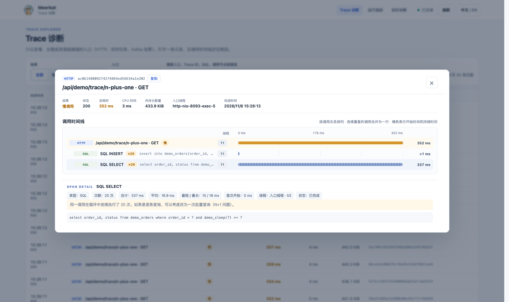
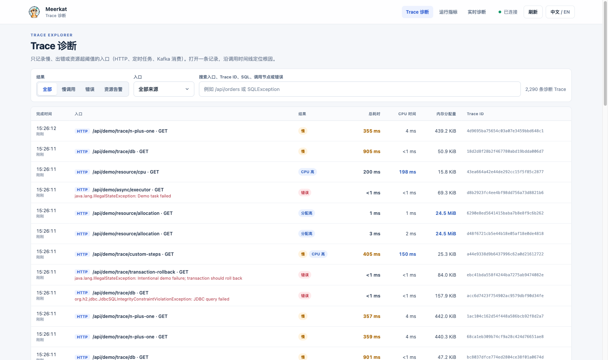
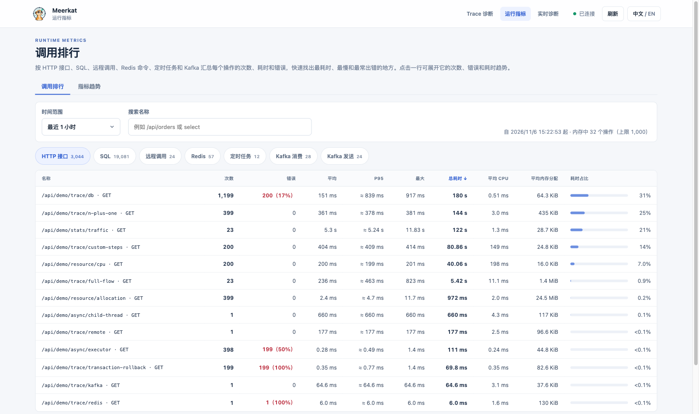
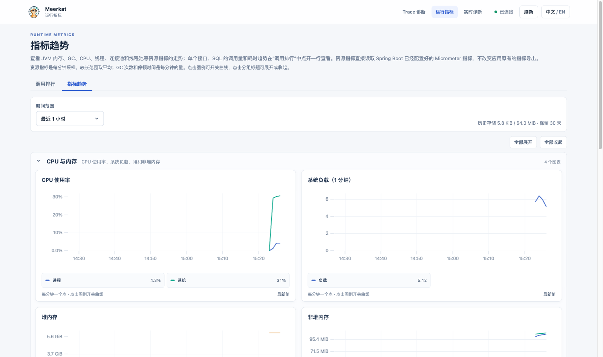
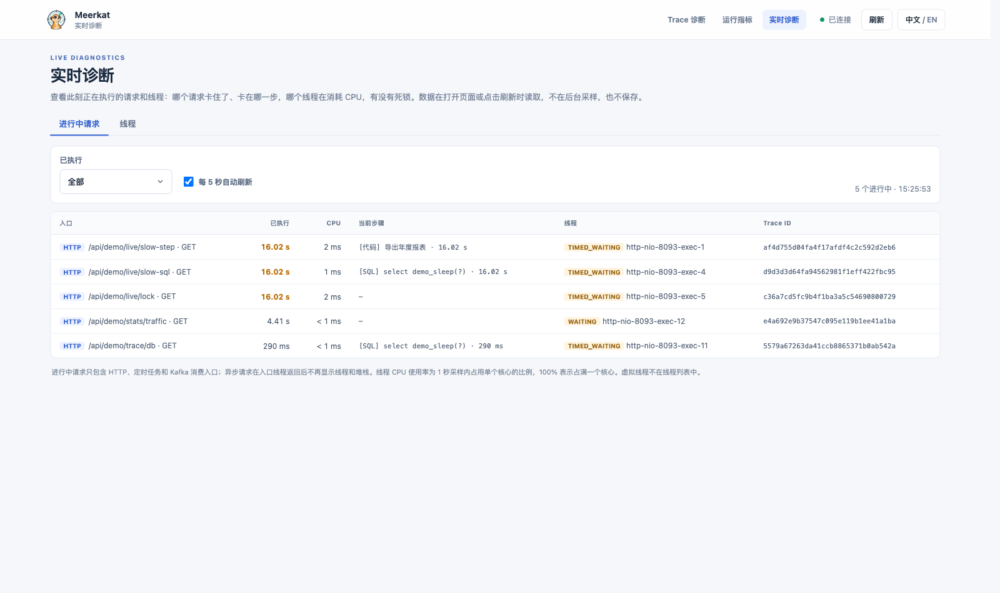

<p align="center">
  
</p>

<h1 align="center">Meerkat</h1>

<p align="center">
  <b>Spring Boot 3/4 内嵌式 Trace 诊断与运行指标。</b><br>
  引入一个依赖即可：不需要 Agent、不需要收集端、不改业务代码。
</p>

<p align="center">
  <a href="https://github.com/lakernote/meerkat/actions/workflows/ci.yml"></a>
  <a href="https://central.sonatype.com/artifact/io.github.lakernote/meerkat-spring-boot-3-starter"></a>
  <a href="https://central.sonatype.com/artifact/io.github.lakernote/meerkat-spring-boot-4-starter"></a>
  
  <a href="LICENSE"></a>
</p>

<p align="center"><a href="README.md">English</a> | 简体中文</p>

Meerkat 在应用内部回答两个日常问题：

- **这次请求为什么慢、异常从哪里开始？** 沿时间线查看 SQL、Redis、HTTP 调用、Kafka 和异步线程。
- **最近有什么变化？** 哪些接口、SQL 和依赖最慢、最频繁、出错最多；JVM、连接池和线程池随时间怎么变化。

不必先部署一套观测平台就能用起来，也能和已有平台并存。



## 功能

- **Trace 诊断**：HTTP、定时任务、Kafka 消费入口中慢、出错或 CPU/内存分配超阈值的调用树；循环里重复的 SQL 合并成一行并提示 N+1。
- **调用排行**：按接口、SQL、远程调用、Redis 命令、定时任务和 Kafka Topic 统计次数、错误率、平均/P95/最大和总耗时，入口另有 CPU 和内存分配；可看最近 1 小时到 30 天，重启不丢。
- **指标趋势**：JVM 内存与 GC、CPU、线程、Hikari 连接池、线程池、Tomcat，复用 Spring Boot 已绑定的 Micrometer 指标。
- **实时诊断**：进行中请求卡在哪一步、线程 CPU 排行、死锁检测、合并堆栈和线程 Dump；按需读取，不在后台采样。
- **自包含**：数据存在本地文件，按保留期和容量上限清理；不影响应用已有的 Prometheus 等 Micrometer 导出。

## 快速接入

选择与 Spring Boot 版本匹配的 Starter（Java 17+，Spring Boot 3.5+ / 4.0+，Servlet 栈；不支持 WebFlux，见[运行环境](docs/guide.zh-CN.md#运行环境)）：

```xml
<!-- Spring Boot 3 -->
<dependency>
    <groupId>io.github.lakernote</groupId>
    <artifactId>meerkat-spring-boot-3-starter</artifactId>
    <version>0.1.0-alpha.4</version>
</dependency>

<!-- Spring Boot 4 -->
<dependency>
    <groupId>io.github.lakernote</groupId>
    <artifactId>meerkat-spring-boot-4-starter</artifactId>
    <version>0.1.0-alpha.4</version>
</dependency>
```

启动应用后打开 `http://localhost:8080/meerkat/`（启动日志也会打印该地址）。页面按浏览器语言显示中文或英文，可在顶部栏切换。

> [!IMPORTANT]
> 默认任何能访问应用端口的人都能查看页面和 API。生产环境请用 Spring Security 或网关保护 `/meerkat/**` 和 `/api/meerkat/**`，或提供 [`ObservabilityAccessPolicy`](docs/guide.zh-CN.md#页面和-api-访问)。

## 自动采集范围

| 组件 | 无需写代码即可采集 |
| --- | --- |
| 入口 | Spring MVC 请求、`@Scheduled` 定时任务、`@KafkaListener` |
| 数据库 | JDBC / 任意 `DataSource` Bean（MyBatis、JPA、JdbcTemplate）、事务 |
| Redis | Lettuce；基于 Redisson 连接工厂的 Spring Data Redis |
| HTTP 客户端 | `RestTemplate`、`RestClient`、`@FeignClient`、`OkHttpClient` Bean（自动传递 Trace ID） |
| 消息 | `KafkaTemplate` 发送与监听消费，按 Trace ID 串联 |
| 异步 | `@Async`、`ThreadPoolTaskExecutor` 和 `SimpleAsyncTaskExecutor` Bean |

自定义步骤可用 `@TraceSpan` 或 `TraceBlock`。具体边界见[指南](docs/guide.zh-CN.md#自动采集范围)。

**与 Micrometer Tracing / OpenTelemetry 互通。** 应用使用 Micrometer Tracing 时，Meerkat 采用相同的 Trace ID，在这里发现的慢请求可以直接到 Zipkin、Jaeger 或 Tempo 中查同一条链路；上游传入的 W3C `traceparent` 也会被识别，见[日志中的 Trace ID](docs/guide.zh-CN.md#日志中的-trace-id)。

## 性能开销

业务线程上增加的耗时（JMH，Apple M4 Pro，JDK 21）：

| 场景 | 增加的耗时 |
| --- | --- |
| 一次入口（HTTP 请求、定时任务、Kafka 消息） | 约 1.7 µs |
| 每次依赖调用（Redis、HTTP、Kafka 发送等） | 约 0.3 µs |
| 每条 SQL | 约 0.1–0.2 µs |

包含 20 次依赖调用的请求合计约 7 µs：1 ms 的请求增加不到 1%，10 ms 的请求不到 0.1%。写盘在后台线程进行。详见[性能开销](docs/guide.zh-CN.md#性能开销)。

## 界面预览

| Trace 诊断列表 | 调用排行 |
| --- | --- |
|  |  |
| **指标趋势** | **实时诊断** |
|  |  |

## 本地体验

示例覆盖 JDBC、Redis、远程 HTTP、Kafka、异步线程池及资源消耗场景：

```bash
docker compose -f examples/docker-compose.yml up -d --wait
mvn -pl examples/meerkat-example-spring-boot-3 -am package
java -jar examples/meerkat-example-spring-boot-3/target/meerkat-example-spring-boot-3-0.1.0-alpha.4.jar
```

打开 `http://localhost:8083/` 点击各个场景。Boot 4 启动方式见[示例说明](examples/README.md)。

## 与其他方案的定位

| | Meerkat | JavaMelody | SkyWalking / Pinpoint | Prometheus + Grafana |
|---|---|---|---|---|
| 部署 | 应用内 Starter | 应用内依赖 | Agent + 收集端、存储、UI | 独立服务 |
| 单次请求调用树 | 慢、错、资源超阈值的入口 | 无 | 有，支持跨服务 | 无 |
| 汇总与趋势 | 调用排行（P95、错误、CPU、内存分配）+ 资源趋势 | 有 | 有 | 有，查询告警最强 |
| 实时诊断 | 进行中步骤、线程 CPU、死锁、Dump | 请求、线程、堆直方图 | 部分产品 | 无 |
| 适合 | 单体或少量服务 | 传统 Java Web 应用 | 多服务、集中运维 | 集中指标与告警 |

Meerkat 不替代集中式 APM 或指标平台，而是给每个服务一个内置视图，并与它们并存。

## 文档

- [接入与配置指南](docs/guide.zh-CN.md)：运行环境、兼容性矩阵、配置、存储、访问控制、日志、公共 API
- [示例说明](examples/README.md)
- [基准测试](benchmarks/README.md)
- [贡献指南](CONTRIBUTING.md) · [安全](SECURITY.md) · [行为准则](CODE_OF_CONDUCT.md)

## 状态

Meerkat 目前处于 **alpha** 阶段，1.0 之前配置和公共 API 仍可能调整；稳定承诺见[公共 API](docs/guide.zh-CN.md#公共-api)。

## 许可证

[Apache License 2.0](LICENSE)
